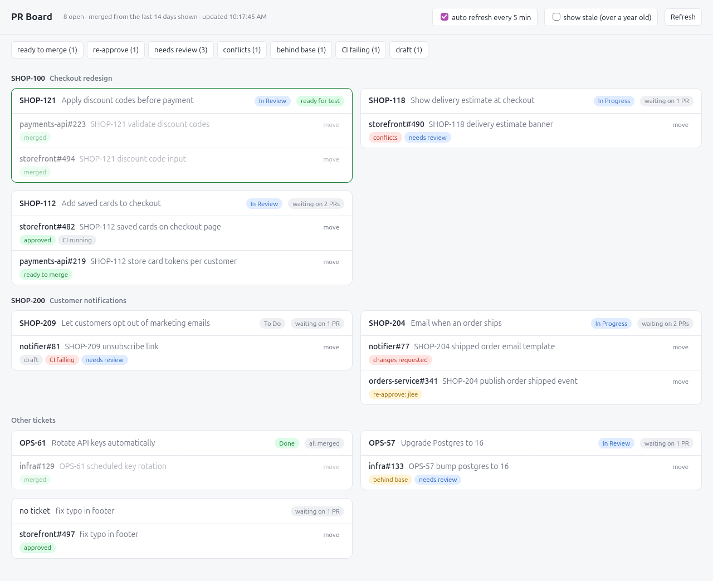

# PR Board

A local dashboard for keeping track of your own GitHub pull requests, grouped by Jira ticket.

<picture>
  <source media="(prefers-color-scheme: dark)" srcset="docs/screenshot-dark.png">
  
</picture>

The board follows your system's light or dark setting.

It runs on your machine as a small Python server with no dependencies. GitHub data comes from your own `gh` login and Jira data from your own API token, so you only ever see your own PRs and nothing leaves your machine except calls to GitHub and Jira.

## What it shows

- Your open PRs, plus anything merged in the last 14 days
- PRs grouped into a card per Jira ticket, and cards grouped under their parent epic
- A status flag on each PR: ready to merge, approved, needs review, changes requested, re-approve (an approval was dismissed), conflicts, behind base, CI failing, CI running, draft, merged
- The Jira summary and status on each card
- Highlighted cards where every PR has merged but the Jira ticket isn't done yet, so you know it's ready to move on

At the top you can filter by flag, pick which Jira statuses to show (the list is built from the statuses on your tickets, and your choice is remembered), hide or show stale PRs (opened over a year ago, hidden by default) and turn auto refresh on or off. Auto refresh reloads every 5 minutes. With it on, the browser sends a notification when a PR becomes ready to merge or a ticket's PRs have all merged.

## Requirements

- python3 3.9+ (standard library only, nothing to pip install)
- [GitHub CLI](https://cli.github.com/), on your `PATH` and logged in with `gh auth login`
- curl
- Linux or macOS
- Jira Cloud, optional

### macOS

- `python3` comes with the Xcode command line tools: `xcode-select --install`
- `gh`: `brew install gh`

`~/.local/bin` isn't on the `PATH` by default, so add this to `~/.zshrc`:

```sh
export PATH="$HOME/.local/bin:$PATH"
```

## Install

```sh
git clone https://github.com/sionpurnell/pr-board.git ~/pr-board
cd ~/pr-board
./install.sh
```

`install.sh` links `pr-board` into `~/.local/bin`. If you don't already have `~/.config/pr-board/config.json`, it copies `config.example.json` there for you to fill in.

## Configuration

Everything lives in `~/.config/pr-board/config.json`:

```json
{
  "orgs": ["your-github-org"],
  "sites": {
    "https://your-company.atlassian.net": {
      "email": "you@your-company.com",
      "token": "your-jira-api-token"
    }
  },
  "projects": {
    "ABC": "https://your-company.atlassian.net"
  }
}
```

| Key | What it does |
| --- | --- |
| `orgs` | GitHub orgs to show PRs from, e.g. `["my-company", "my-open-source-org"]`. Leave it as `[]` to show your PRs from every repo on GitHub. |
| `sites` | Your Jira Cloud sites, each with the Atlassian email and API token to log in with. |
| `projects` | Maps each Jira project key (the `ABC` in `ABC-123`) to the site it lives on. Tickets from projects not listed here are still grouped, just without Jira details. |

The config holds your token, so it stays in `~/.config` and is never committed. `install.sh` creates it readable only by you. If you create it yourself instead, run `chmod 600 ~/.config/pr-board/config.json` so other users on the machine can't read your token. Changes are picked up on the next refresh, no restart needed.

### Jira API token

Jira is optional. Without it the board still works, just without ticket summaries, statuses and epic grouping. To set it up:

1. Create an API token at https://id.atlassian.com/manage-profile/security/api-tokens
2. Put your Atlassian email and the token under each site in `sites`. One token works across every site your Atlassian account can access.

## Usage

```sh
pr-board            # starts the server if it isn't running and opens the board
pr-board restart    # restarts the server, e.g. after pulling changes
```

The board runs at http://localhost:8765. To use a different port, set `PR_BOARD_PORT`, e.g. `PR_BOARD_PORT=9000 pr-board`.

The server keeps running in the background after you close the terminal. Running `pr-board` again just opens the board. It doesn't start on login, so after a reboot run `pr-board` again.

### Linking PRs to tickets

The ticket comes from a key like `ABC-123` in the PR title, falling back to the branch name, so a PR titled `ABC-123 fix login` or on a branch called `ABC-123-fix-login` both land on the `ABC-123` card.

If neither has a key, the PR lands under "no ticket". To put a PR on a different ticket, click **move** next to it and enter the ticket key. Leave it blank to go back to the automatic one. Manual assignments are saved to `~/.config/pr-board/overrides.json`.

## Updating

```sh
cd ~/pr-board && git pull && pr-board restart
```

## Troubleshooting

- **"pr board failed to start"**: the server log is printed with the error and kept at `~/.local/state/pr-board.log`. The most common cause is something else already using port 8765, which you can fix by setting `PR_BOARD_PORT`.
- **The board shows "failed to load the board"**: the real error is in `~/.local/state/pr-board.log`. The usual causes are:
  - `gh` isn't logged in. Run `gh auth status` in the same terminal you start `pr-board` from.
  - `gh` can't be found (`FileNotFoundError` in the log). Check `which gh` in that terminal. If it's installed as a snap, `/snap/bin` needs to be on your `PATH`. Then run `pr-board restart`.
- **A Jira error banner shows**: the email or token in your config is wrong for that site, or your account can't see that project.
- **The board is empty**: check `orgs` in your config is spelt the same as on GitHub.
- **No notifications**: allow notifications for `localhost` in your browser. You're asked when you first change the auto refresh setting.

## License

MIT, see [LICENSE](LICENSE).
